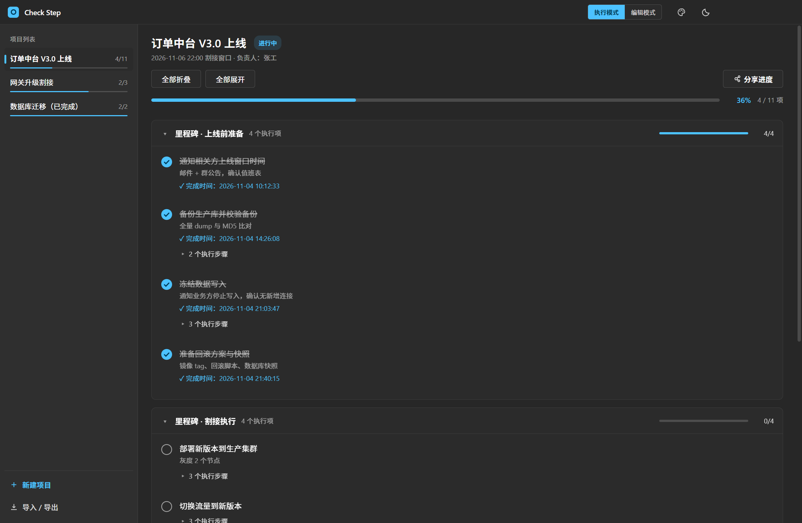
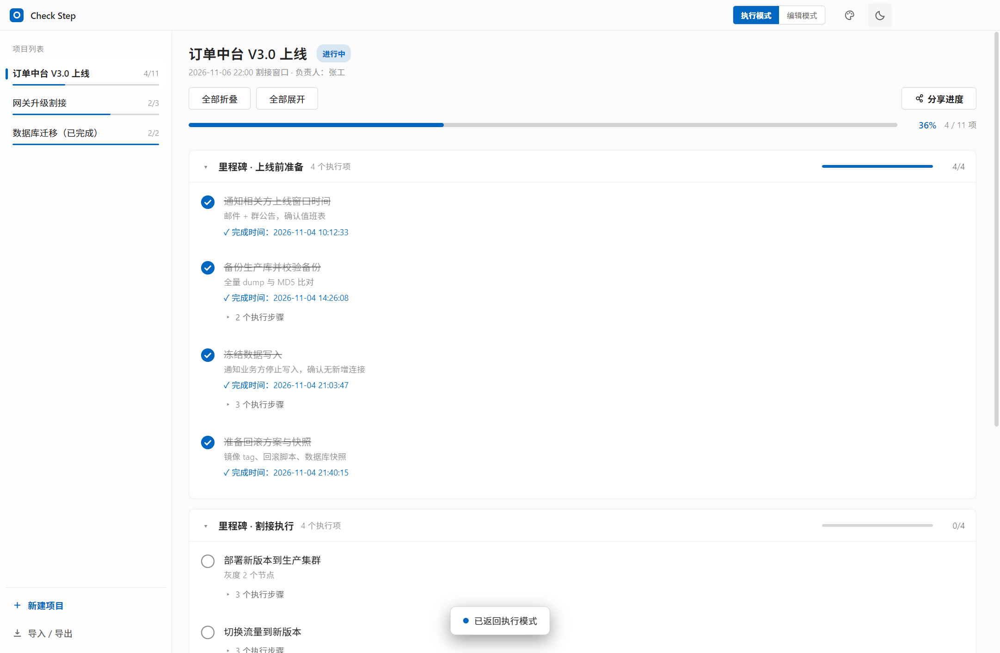
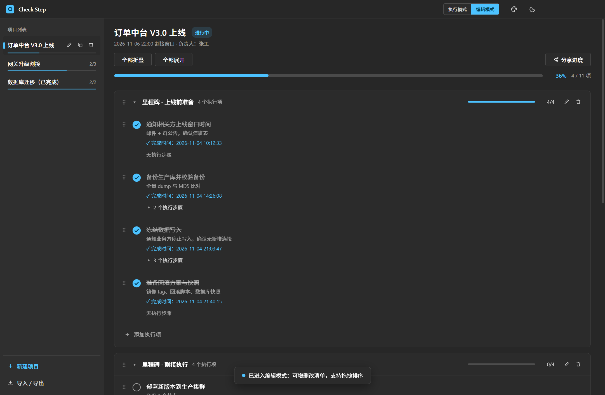
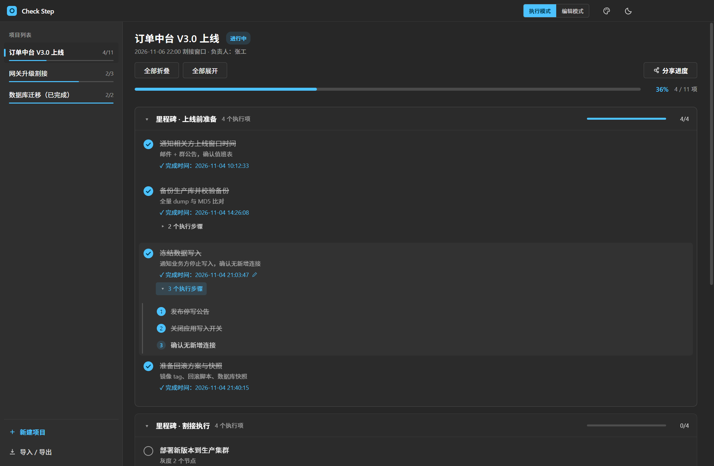
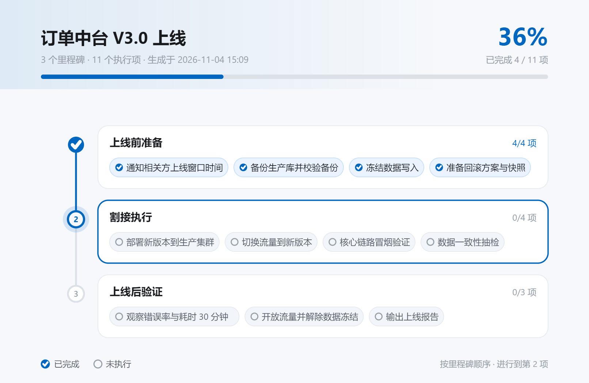

<div align="center">


# Check Step

**上线操作检查清单桌面应用 · 按步骤执行，不漏项**

[](CHANGELOG.md)
[](https://www.electronjs.org/)
[](https://react.dev/)
[](https://www.typescriptlang.org/)
[](LICENSE)

</div>

---

Check Step 是一款面向 **系统上线 / 割接 / 迁移** 场景的本地检查清单工具。它把一次上线操作组织为

> **项目 → 里程碑 → 执行项 → 执行步骤**

的四层结构，执行模式专注打勾登记，编辑模式负责维护清单，全程本地存储、离线可用，并支持一键生成进度时间线图用于分享汇报。

<div align="center">
  
</div>

## ✨ 功能特性

- **四层清单结构**：项目 / 里程碑 / 执行项 / 执行步骤，逐层拆解上线动作
- **双模式工作流**：
  - *执行模式* —— 点击圆圈登记完成，自动记录完成时间（可修改），步骤逐项打勾
  - *编辑模式* —— 增删改项目、里程碑、执行项、步骤，全部支持拖拽排序与跨分组移动
- **执行项步骤**：每个执行项可挂多行连续录入的执行步骤，勾完步骤再勾执行项
- **吸顶进度栏**：滚动浏览长清单时，项目名与总进度始终固定在内容区顶部
- **全部折叠 / 展开**：一键收起或展开所有里程碑，快速纵览全局
- **待办悬浮定位**：视口内看不到未执行项时，右下角出现「待办」悬浮按钮，点击自动展开分组、滚动定位并高亮最早的未执行项
- **分享进度图**：按里程碑顺序生成纵向时间线图（不含具体完成时间），配色自动跟随当前深浅主题与主题色，支持复制到剪贴板或保存 PNG
- **导入 / 导出**：
  - JSON 全量备份（全部项目）或单项目导出，跨设备迁移
  - Markdown 清单导出，便于评审与归档
  - 导入时自动校验结构、重生成 ID，支持「追加」或「替换」两种方式
- **项目复制**：完整复制清单结构，执行状态自动重置——同类型上线操作复用清单的利器
- **深浅主题 + 8 种主题色**：跟随系统初始化，可随时切换；配色同步应用到勾选、进度条、按钮与分享图
- **数据安全**：本地 JSON 原子写入（临时文件 + 重命名），损坏自动备份；删除操作均有二次确认

## 🖼 界面预览

| 执行模式（浅色） | 编辑模式（拖拽维护清单） |
| --- | --- |
|  |  |

| 步骤清单 | 分享进度时间线图 |
| --- | --- |
|  |  |

## 📦 安装

### 方式一：下载安装包（推荐）

从 [Releases](https://github.com/markljq/checkstep/releases) 下载最新 `CheckStep-Setup-x.x.x.exe`，双击安装（Windows 10/11 x64）。

- 安装时可选自定义目录
- 自动创建桌面与开始菜单快捷方式
- 卸载不会删除用户数据（见 [数据存储位置](#-数据与存储)）

### 方式二：从源码运行

```bash
git clone <your-repo-url>
cd checkstep-desktop
npm install
npm run dev        # 开发模式启动（热更新）
```

> 环境要求：Node.js ≥ 18，Windows（其他平台可运行，但打包脚本按 Windows 配置）

## 🛠 开发与构建

```bash
npm run dev          # 开发模式（electron-vite dev）
npm run build        # 构建渲染产物到 out/
npm run typecheck    # TS 类型检查（web + node 两个 tsconfig）
npm run dist         # 构建并打包 Windows NSIS 安装包到 dist/
```

### 测试

基于 `playwright-core` 驱动真实 Electron 进程的端到端测试：

```bash
node tests/smoke.mjs        # 冒烟：启动、数据读写、核心交互
node tests/features.mjs     # 功能：导入导出、完成时间编辑
node tests/duplicate.mjs    # 复制：项目/执行项复制与状态重置
node tests/optimize.mjs     # 交互：吸顶、折叠、悬浮定位
node tests/v105.mjs         # 分享进度图与步骤编辑
node tests/verify-dist.mjs  # 对 dist 产物做安装级验证
```

### 辅助脚本

```bash
npx electron scripts/gen-icon.js          # 由 build/icon.svg 重新生成 build/icon.png
node scripts/gen-screenshots.mjs          # 重新生成 docs/images 下的界面截图
```

## 📁 项目结构

```
checkstep-desktop
├── build/                  # 打包资源（icon.png / icon.svg 应用图标）
├── docs/
│   ├── images/             # README 截图
│   ├── USER-GUIDE.md       # 使用说明（面向使用者）
│   └── ARCHITECTURE.md     # 技术文档（面向开发者）
├── scripts/
│   ├── gen-icon.js         # SVG → PNG 图标渲染
│   └── gen-screenshots.mjs # README 截图生成
├── src/
│   ├── main/index.ts       # 主进程：窗口、IPC、JSON 持久化
│   ├── preload/            # contextBridge 预加载（window.api）
│   └── renderer/src/
│       ├── App.tsx         # 应用外壳：标题栏、模式切换、主题
│       ├── store.ts        # 全局状态 + 持久化 + 拖拽/导入导出纯逻辑
│       ├── transfer.ts     # 导入 / 导出流程
│       ├── types.ts        # 数据模型定义
│       └── components/
│           ├── Sidebar.tsx       # 项目列表与导入导出入口
│           ├── ProjectView.tsx   # 里程碑 / 执行项视图与分享进度
│           ├── TaskItem.tsx      # 执行项与步骤
│           ├── TimelineImage.ts  # 时间线图 SVG 生成与 PNG 导出
│           └── Dialogs.tsx       # 表单 / 确认 / 步骤对话框与 Toast
├── tests/                  # Playwright + Electron 端到端测试
├── electron.vite.config.ts
└── package.json
```

## 💾 数据与存储

所有数据保存在本地，不上传任何服务器：

| 内容 | 位置（Windows） |
| --- | --- |
| 清单数据 | `%APPDATA%\checkstep-desktop\data\checkstep.json` |
| 运行日志 | `%APPDATA%\checkstep-desktop\main.log` |

- 写入采用**原子写**：先写临时文件再重命名覆盖，避免写一半崩溃损坏数据
- JSON 解析失败时自动备份为 `checkstep.json.corrupt-<时间戳>.bak` 后重建
- 建议定期用「导入 / 导出 → JSON 备份 · 全部项目」导出异地备份

JSON 结构与字段说明见 [docs/ARCHITECTURE.md · 数据模型](docs/ARCHITECTURE.md#数据模型)。

## 📚 文档

| 文档 | 内容 |
| --- | --- |
| [使用说明](docs/USER-GUIDE.md) | 安装、各界面功能详解、导入导出、数据备份、FAQ |
| [技术文档](docs/ARCHITECTURE.md) | 架构设计、进程通信、状态管理、数据模型、构建打包、测试 |
| [更新日志](CHANGELOG.md) | 各版本变更记录 |

## ❓ FAQ

**Q：数据会同步到云端吗？**
不会。Check Step 完全本地运行，数据只存在本机 JSON 文件中，跨设备迁移请使用 JSON 导出 / 导入。

**Q：误删了执行项能恢复吗？**
应用内删除不可恢复（均有二次确认）。若此前导出过 JSON 备份，可通过「替换全部数据」回滚。

**Q：为什么复制出来的项目都是未完成状态？**
复制项目的定位是「复用清单模板」——结构与备注完整保留，执行状态与完成时间全部重置，方便直接开始下一次上线。

**Q：分享的进度图包含完成时间吗？**
不包含。时间线图只展示「已完成 / 未执行」状态与整体进度，适合对外分享而不泄露操作细节。

## 📄 许可证

[MIT](LICENSE)
